<div align="center">
  
  <h1>Youneko Rate!</h1>
  <p>Rate your local music library privately, clearly, and offline.</p>
  <p>
    <a href="README.vi.md">Đọc README tiếng Việt</a>
  </p>
  <p>
    <a href="https://developer.android.com/"></a>
    <a href="app/build.gradle.kts"></a>
    <a href="gradle/libs.versions.toml"></a>
    <a href="LICENSE"></a>
    
    
  </p>
</div>

## Contents

- [✨ Features](#-features)
- [📸 Screenshots](#-screenshots)
- [🛠️ Technology](#️-technology)
- [📋 Requirements](#-requirements)
- [🔨 Build](#-build)
- [🔒 Privacy](#-privacy)
- [⚠️ Limits](#️-limits)
- [🐾 Thanks](#-thanks)

Youneko Rate! is a private, offline-first companion for rating and keeping notes on your local music library. It scans the audio on your device, stores ratings, reviews, tags and listening logs locally, and adds audio-quality inspection and personal statistics without requiring an account or a server. The Material 3 interface is now built to feel at home on both phones and tablets.

<hr>

## ✨ Features


The app is organized around four principal areas plus an adaptive layout layer:

| Area | Current capability |
|---|---|
| **Library** | Scans local audio through MediaStore and optional SAF folders, then enriches local metadata and artwork. Adaptive grid or list, search, filters and six sort modes keep large libraries manageable. |
| **Rate** | Half-star ratings (or 10/100-point scales), album and track reviews, tags, listening logs, rating progress, and a full album editor for correcting metadata and cover art. |
| **Analyze** | Decode-only inspection with STFT/FFT data, sample rate, bit depth, bitrate, cutoff and spectral indicators whenever the source provides enough data. |
| **Stats** | Overview tiles, top-rated album, score distribution, averages by listen date, quality/artist/label/credit rankings, and a locally rendered share card. |
| **Adaptive UI** | Material 3 layout with bottom navigation on phones, a navigation rail on tablets, a two-pane album detail on large tablets, light/dark themes and complete EN/VI resources. |

The interface is built around local data, Material 3, bilingual resources, a paw launcher/splash identity and artwork kept in the app's private storage.

### Interface refresh

- Library, Rate, Album detail, Analyze, Stats and Settings were rebuilt around the same adaptive layout system.
- Album detail now keeps ratings inline, handles review/tag/listening tools in focused cards, and switches to a two-pane cover + tracklist layout on large screens.
- Settings is fully scrollable and grouped; provider tokens, credit sources, backup and diagnostics live in dedicated cards.
- Stats now groups averages by the album listen date, shows a real distribution chart and renders a brand-consistent share card.
- All user-facing copy, validation messages and rating-scale labels are localized in English and Vietnamese.

<hr>

## 📸 Screenshots

The previews below are rendered directly from the Compose sources at 411 dp (phone), 800 dp (tablet) and 1200 dp (large tablet). They are UI previews, not physical-device captures; real-device screenshots can replace them at any time.

| Phone · Library | Phone · Album detail |
|---|---|
| 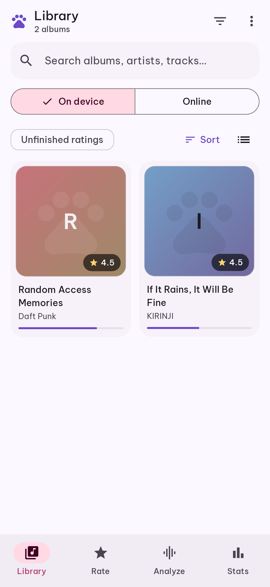<br><sub>Library · adaptive grid and quick filters</sub> | 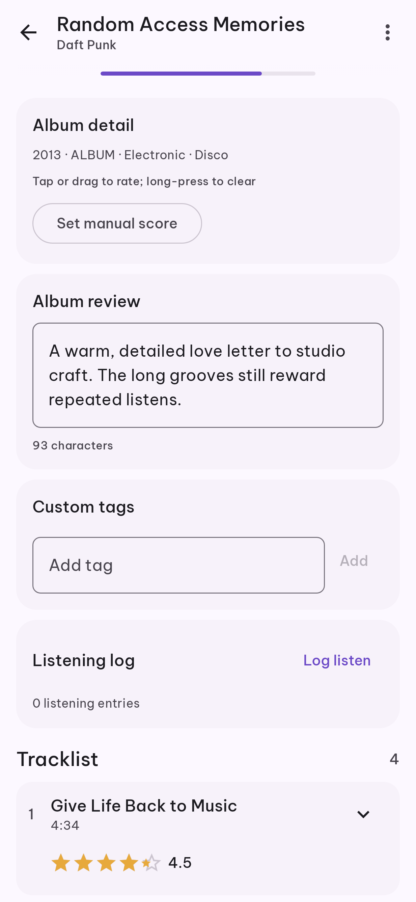<br><sub>Album detail · inline ratings and notes</sub> |
| Phone · Rate | Phone · Stats |
|---|---|
| 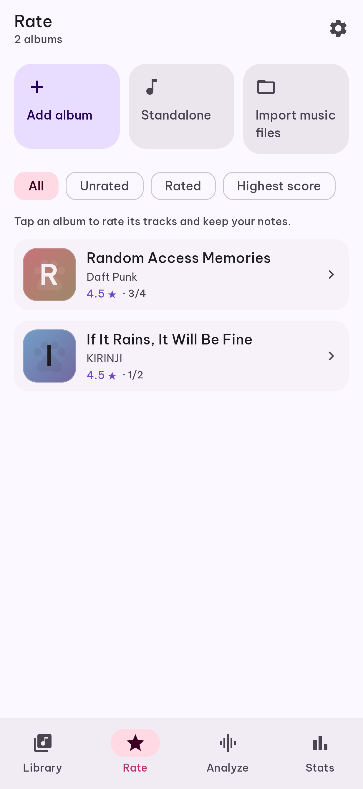<br><sub>Rate · quick actions and progress</sub> | 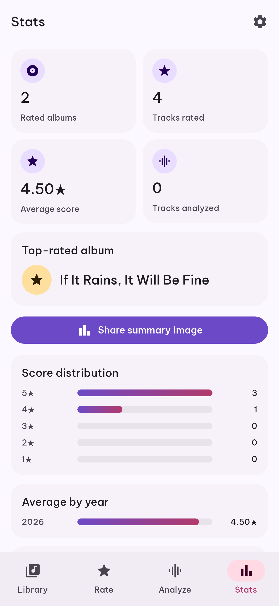<br><sub>Stats · overview and distribution</sub> |
| Phone · Analyze | Share card |
|---|---|
| 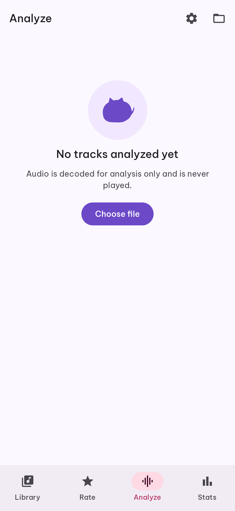<br><sub>Analyze · decode-only inspection</sub> | 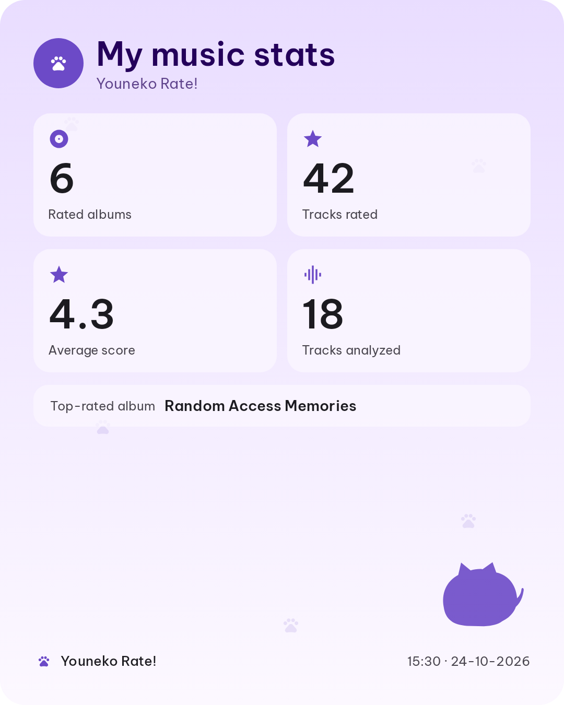<br><sub>Share card · rendered locally</sub> |
| Phone · Edit album | Phone · Dark theme |
|---|---|
| 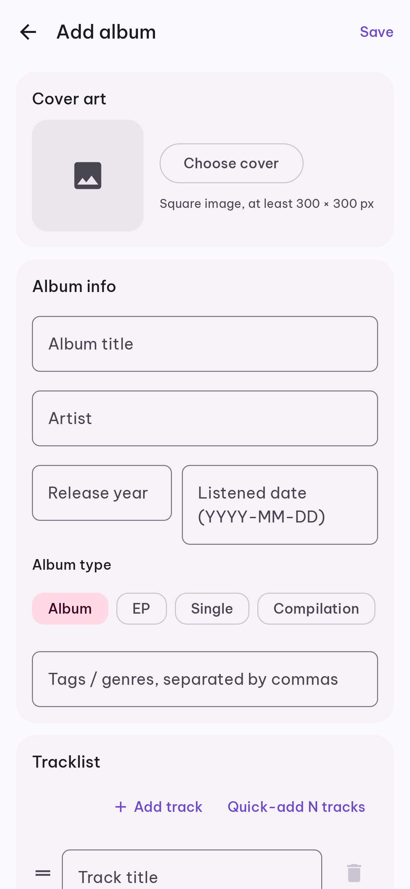<br><sub>Editor · metadata, cover and tracklist</sub> | 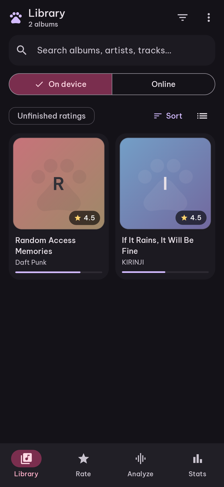<br><sub>Dark theme · brand palette</sub> |
| Tablet · Library | Tablet · Settings |
|---|---|
| 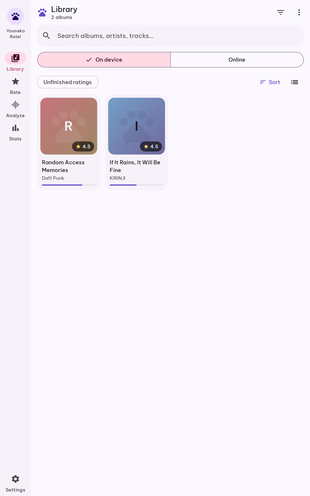<br><sub>Tablet · navigation rail</sub> | 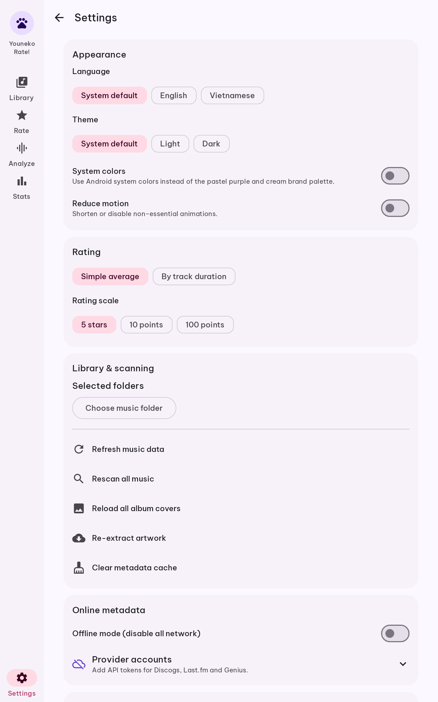<br><sub>Settings · grouped, scrollable sections</sub> |

<p align="center">
  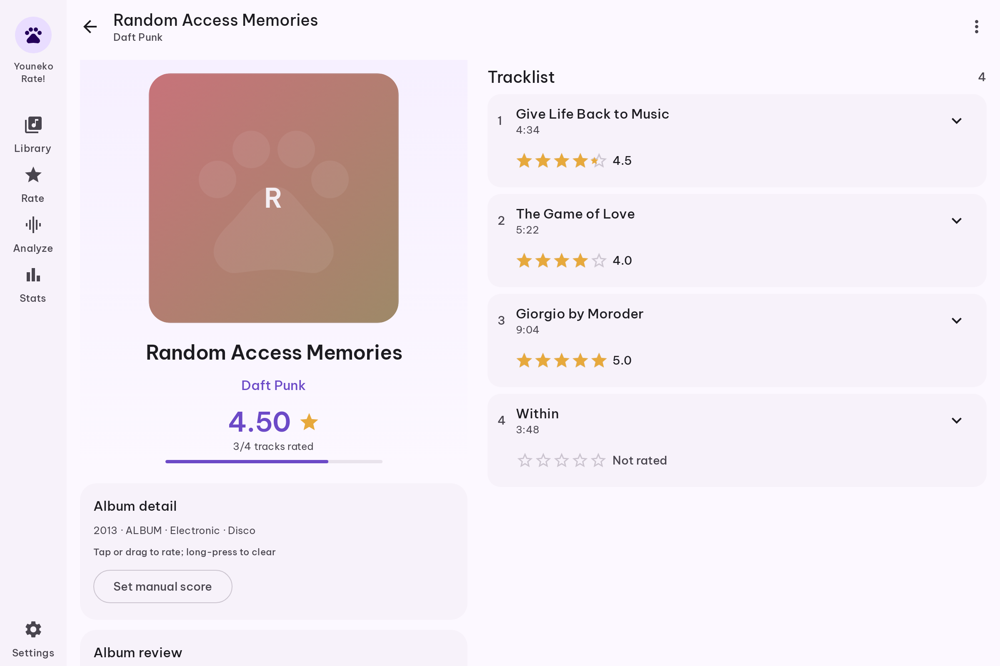<br>
  <sub>Large tablet · two-pane album detail with cover, notes and tracklist</sub>
</p>

<hr>

## 🛠️ Technology

The versions below are read from `gradle/libs.versions.toml` and `app/build.gradle.kts`.

| Area | Actual implementation |
|---|---|
| Language and UI | Kotlin `2.4.10`, Jetpack Compose, Compose BOM `2026.08.00`, Material 3 |
| Android build | Android Gradle Plugin `9.3.1`, Gradle wrapper `9.5.0`, compile SDK `37`, min SDK `26`, target SDK `36` |
| Local data | Room `2.8.4` with KSP and exported schemas; DataStore Preferences `1.2.1` |
| Dependency injection | Hilt `2.60.1` and Hilt Navigation Compose `1.4.0` |
| Background work | WorkManager `2.11.2` for scans and other long-running local operations |
| Images and artwork | Coil `2.7.0`, AndroidX Palette `1.0.0`, AndroidX ExifInterface `1.3.7` |
| Audio and tags | MediaExtractor, MediaCodec, MediaMetadataRetriever, jaudiotagger `3.0.1`, JTransforms `3.1` |
| Platform support | core-ktx `1.19.0`, core-splashscreen `1.0.1`, Activity Compose `1.13.0`, Navigation Compose `2.9.8` |
| Adaptive layout | Custom window-width breakpoints, `NavigationRail` from 600 dp, bottom navigation on phones, two-pane album detail from 840 dp |

The code uses a practical MVVM and repository/data-layer structure. Compose screens observe `StateFlow` from ViewModels; DAOs provide Room data, Hilt supplies dependencies, DataStore stores preferences and scan state, and WorkManager handles longer operations.

<hr>

## 📋 Requirements

| Setting | Value |
|---|---:|
| `minSdk` | 26 |
| `targetSdk` | 36 |
| `compileSdk` | 37 |
| Java/JDK | 17 |
| Kotlin | 2.4.10 |

<details>
<summary>Android permissions</summary>

| Permission | Why it is requested |
|---|---|
| `READ_MEDIA_AUDIO` on Android 13+ | Read local audio metadata from MediaStore. |
| `READ_EXTERNAL_STORAGE` on Android 12 and older | Read the equivalent local audio library on older Android versions. |
| `INTERNET` | Support explicitly requested online metadata actions already present in the beta. |
| `FOREGROUND_SERVICE` and `FOREGROUND_SERVICE_DATA_SYNC` | Keep long-running local data work visible with a notification. |

The app does not request `MANAGE_EXTERNAL_STORAGE`.

</details>

<hr>

## 🔨 Build

<details open>
<summary>Build steps</summary>

```bash
git clone https://github.com/dungzual201/youneko-rate.git
cd youneko-rate
cp local.properties.example local.properties
# Set sdk.dir if Android Studio does not discover your SDK automatically.
./gradlew assembleDebug
```

The debug APK is written to:

```text
app/build/outputs/apk/debug/app-debug.apk
```

For the complete local verification suite:

```bash
./gradlew assembleDebug testDebugUnitTest lintDebug compileDebugAndroidTestKotlin
```

</details>

<details>
<summary>Project structure</summary>

```text
app/src/main/java/com/youneko/rate/
├── data/           # Room entities/DAOs, repositories, import, scan, artwork and workers
├── di/             # Hilt and database dependency wiring
├── navigation/     # Adaptive Compose navigation graph and routes
├── ui/
│   ├── adaptive/   # Window-size helpers, page padding and responsive columns
│   ├── analyze/    # Decode-only audio analysis and spectrogram UI
│   ├── artwork/    # Cover display, palette and cache-aware image loading
│   ├── components/ # Shared Material 3 top bar, cards, ratings and progress
│   ├── coversearch/# Cover picker flow
│   ├── export/     # Backup, restore, CSV/JSON export and share collages
│   ├── importer/   # Local audio import preview and save flow
│   ├── media/      # Permission onboarding and scan progress
│   ├── musicbrainz/# Online metadata search
│   ├── phase12/    # Collections, artist pages and advanced search
│   ├── rate/       # Library, Rate, album detail, editor, settings, star rating
│   └── stats/      # Statistics and share-card rendering
└── res/            # Bilingual strings, themes, launcher/splash and vector assets
```

</details>

<hr>

## 🔒 Privacy

> **Privacy by design:** local ratings, reviews and library metadata stay on the device. The app requires no account, has no advertising or analytics, and does not require a server for local use.

Artwork imported into the app is stored under its private `filesDir/covers/` directory and is not written into the original audio file. A missing source file is marked `isMissing` instead of deleting its rating, review or manually entered data. Database migrations are explicit; the project does not use `fallbackToDestructiveMigration()`.

<hr>

## ⚠️ Limits

This is a personal beta project. The app has **no playback**, does not write tags into the original audio file, and does not fetch lyrics online. Embedded lyrics can be read from file tags. Backup/restore covers ratings, reviews, tags, listening logs and manual credits; music files and API tokens are never included.

The screenshots above are Compose previews, not physical-device captures, and this workspace contains no device performance measurements. UI behavior may still change as the beta is tested on real hardware. See `docs/PROGRESS.md` for the phase ledger.

<hr>

## 🐾 Thanks

Thanks to the open-source Android ecosystem and to everyone testing this personal beta project. Behavior, local data flows and UI details may change as unfinished phases are evaluated.

<p align="center">
  
</p>

The project is released under the [MIT License](LICENSE).
